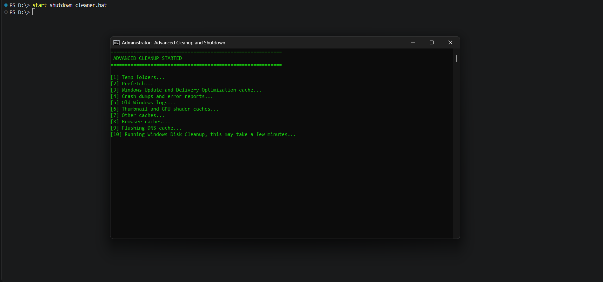
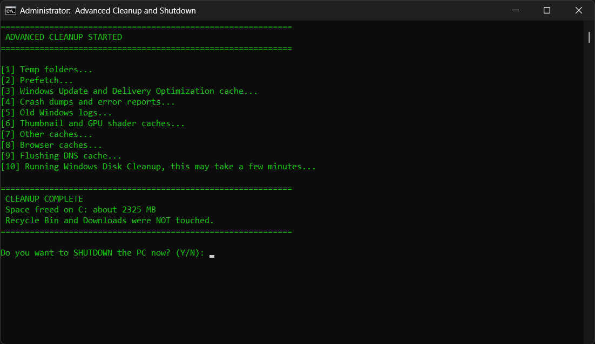
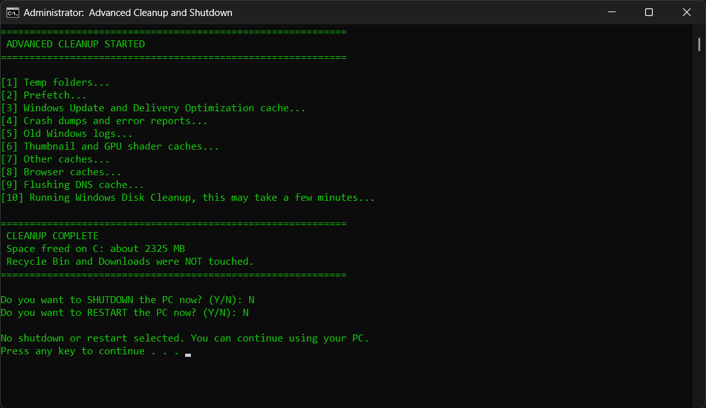

# 🧹 Windows-Cleanup-Shutdown-Bat 🔌

An **Advanced Windows Batch Script** that cleans **temp files, prefetch, update cache, crash dumps, logs and browser caches**, runs **silent Disk Cleanup**, shows **how many MB were freed**, and then asks **Y/N to shutdown or restart** your PC — all from one double-click.

This script is built for **everyday PC cleanup**, **freeing disk space before shutting down**, and **learning Windows batch scripting**, combining **auto Administrator elevation**, **safe cleanup rules** and **easy on/off settings** at the top of the file.

---

## 🧱 Project Structure

```bash
windows-cleanup-shutdown-bat/
│
├── assets/                 # Screenshots
├── shutdown_cleaner.bat    # Main cleanup + shutdown/restart script
├── LICENSE                 # Project license
└── README.md               # Project documentation
```

---

## ✨ Features

### 🧹 Deep Cleanup (11 Steps)

- **Temp folders** — user, local and Windows `Temp`
- **Prefetch** files
- **Windows Update** download cache and **Delivery Optimization** cache
- **Crash dumps** and **error reports** (Minidump, `MEMORY.DMP`, WER)
- Old **Windows logs** (CBS, DISM, Panther, WindowsUpdate)
- **Thumbnail cache** and **GPU shader caches** (D3D, NVIDIA, AMD)
- Other caches — **INetCache**, **pip cache**, **Package Cache**
- **Browser caches** — Chrome, Edge and Firefox (all profiles)
- **DNS cache** flush
- Windows **Disk Cleanup** (`cleanmgr`) in silent mode
- Optional **DISM** component store cleanup

### 📊 Space Report

- Measures free space on `C:` **before** and **after** the cleanup
- Shows **about how many MB were freed** at the end

### 🔒 Safe by Design

- Does **NOT** touch the **Recycle Bin**, **Downloads**, **Documents**
- Does **NOT** touch browser **passwords, cookies or history** (only cache folders are cleaned)
- Recycle Bin and Downloads are deliberately **not selected** in Disk Cleanup

### 🔌 Shutdown / Restart Prompt

- Asks **Y/N** to **SHUTDOWN** the PC
- If **N** → asks **Y/N** to **RESTART** the PC
- If **N** again → leaves the PC running so you can keep using it
- Shutdown / restart starts after a short delay and can be cancelled with `shutdown /a`

### ⚙️ Easy Settings

- Turn features on/off by changing simple variables at the top of the script
- Auto-elevates to **Administrator** (no need to right-click → Run as administrator)

### ⚡ Settings at a Glance

| Setting          | Default | Meaning                                                  |
| ---------------- | ------- | -------------------------------------------------------- |
| `RUN_CLEANMGR`   | `1`     | Run Windows Disk Cleanup in silent mode                  |
| `RUN_DISM`       | `0`     | Component store cleanup (slow, but frees a lot of space) |
| `CLEAN_BROWSERS` | `1`     | Clean Chrome / Edge / Firefox cache folders              |
| `KILL_BROWSERS`  | `0`     | Force close browsers so their cache files are not locked |
| `FLUSH_DNS`      | `1`     | Flush the DNS cache                                      |
| `POWER_DELAY`    | `5`     | Seconds to wait before shutdown / restart                |

---

## 🛠 Technologies Used

| Technology              | Purpose                                           |
| ----------------------- | ------------------------------------------------- |
| **Batch Script (.bat)** | Core script and cleanup logic                     |
| **PowerShell**          | Auto Administrator elevation and free-space check |
| **cleanmgr**            | Windows Disk Cleanup in silent mode               |
| **DISM**                | Component store cleanup (optional)                |
| **net / taskkill**      | Stopping and starting services, closing browsers  |
| **choice**              | Y/N prompts                                       |
| **shutdown**            | Shutdown and restart                              |

---

## ▶️ How to Run

### 1️⃣ Clone the repository

```bash
git clone https://github.com/ShakalBhau0001/windows-cleanup-shutdown-bat.git
```

### 2️⃣ Enter the project directory

```bash
cd windows-cleanup-shutdown-bat
```

### 3️⃣ (Optional) Change the settings

Open `shutdown_cleaner.bat` in a text editor and edit the variables at the top:

```bat
set RUN_CLEANMGR=1
set RUN_DISM=0
set CLEAN_BROWSERS=1
set KILL_BROWSERS=0
set FLUSH_DNS=1
set POWER_DELAY=5
```

### 4️⃣ Running the Script

#### Double-click

```bash
shutdown_cleaner.bat
```

#### From PowerShell / Command Prompt

```bash
start shutdown_cleaner.bat
```

> ℹ️ The script asks for **Administrator rights** automatically — click **Yes** on the UAC prompt.

---

## ▶️ Usage

```bash
============================================================
 ADVANCED CLEANUP STARTED
============================================================

[1] Temp folders...
[2] Prefetch...
[3] Windows Update and Delivery Optimization cache...
[4] Crash dumps and error reports...
[5] Old Windows logs...
[6] Thumbnail and GPU shader caches...
[7] Other caches...
[8] Browser caches...
[9] Flushing DNS cache...
[10] Running Windows Disk Cleanup, this may take a few minutes...

============================================================
 CLEANUP COMPLETE
 Space freed on C: about 2325 MB
 Recycle Bin and Downloads were NOT touched.
============================================================

Do you want to SHUTDOWN the PC now? (Y/N):
```

### 1. Shutdown

```bash
Do you want to SHUTDOWN the PC now? (Y/N): Y
Shutting down in 5 seconds... (run "shutdown /a" to cancel)
```

### 2. Restart

```bash
Do you want to SHUTDOWN the PC now? (Y/N): N
Do you want to RESTART the PC now? (Y/N): Y
Restarting in 5 seconds... (run "shutdown /a" to cancel)
```

### 3. Keep using the PC

```bash
Do you want to SHUTDOWN the PC now? (Y/N): N
Do you want to RESTART the PC now? (Y/N): N

No shutdown or restart selected. You can continue using your PC.
Press any key to continue . . .
```

---

## 📁 Requirements

- **Operating System:** Windows (Command Prompt, PowerShell and `cleanmgr` are used)
- **Permissions:** Administrator rights (the script requests them automatically)
- **Drive:** The space report is measured on `C:`
- **Internet Connection:** Not required

> ⚠️ Close your important work before running — the script can **shut down or restart** your PC when you choose **Y**.

---

## ⚙️ How It Works

**1️⃣ Auto Elevation**

- Checks for Administrator rights using `net session`
- If not admin → relaunches itself through PowerShell with **RunAs**

**2️⃣ Free Space Before**

- Reads the free space of `C:` in MB using PowerShell

**3️⃣ Cleanup Steps**

- A small helper (`:cleandir`) deletes all files and subfolders **inside** a folder and keeps the folder itself
- Windows Update cache cleanup **stops** `wuauserv`, `bits` and `dosvc`, cleans the folders, and **starts** them again
- Browser cleanup removes only the `Cache`, `Code Cache`, `GPUCache` (Chrome / Edge) and `cache2` (Firefox) folders of every profile

**4️⃣ Disk Cleanup (cleanmgr)**

- Selects a list of Disk Cleanup items through registry flags (`StateFlags1337`)
- Runs `cleanmgr /sagerun:1337` in silent mode
- Recycle Bin and Downloads are not part of the list

**5️⃣ Space Report**

- Reads the free space again and shows **after − before** as the freed space

**6️⃣ Shutdown / Restart**

- Uses `choice` for the Y/N questions
- Runs `shutdown /s` or `shutdown /r` after `POWER_DELAY` seconds

---

## ⚠️ Common Errors

- **UAC prompt declined** → The script cannot clean system folders without Administrator rights
- **Some files are not deleted** → Files in use are locked by Windows or apps — close them, or set `KILL_BROWSERS=1` for browser caches
- **Space freed shows `0` or a small number** → The PC was already clean, or other programs used disk space while the script ran
- **Disk Cleanup takes long** → Step 10 can take a few minutes — wait for it to finish
- **PC shuts down unexpectedly** → You chose **Y** at the prompt — run `shutdown /a` within the delay to cancel
- **Script closes immediately** → Run it from PowerShell or Command Prompt to read any message

---

## 🌟 Future Enhancements

- Save a **cleanup log** with the list of cleaned locations
- Support for **other drives** in the space report
- Option to **dry-run** (show what will be cleaned without deleting)
- Add **Brave / Opera** browser cache cleanup
- Add a **countdown** with a cancel option before shutdown
- Add an option to **schedule** the cleanup automatically

---

## 📦 Related Projects

This repository focuses on a **simple Windows maintenance automation script**
implemented as a **batch scripting learning project**.

The goal of this project is to:

- Understand which Windows folders hold **temporary and cache files**
- Practice **batch scripting** (labels, loops, `choice`, helper functions)
- Learn how to **elevate privileges** and use built-in Windows tools safely

For more advanced, security-focused CLI tools, check out:

> 🔗 **[CLI Projects](https://github.com/stars/ShakalBhau0001/lists/cli-projects)**

---

## ⚠️ Disclaimer

> This project is intended for **educational and learning purposes only**.

> _This script permanently deletes temporary files, caches, logs and Windows Update downloads, and Disk Cleanup items cannot be restored once removed. Prefetch cleanup may make the first launch of some apps slightly slower. Read the script before running it, and use it at your own risk._

---

## 📸 Preview

### 1. **Script Started**



### 2. **Cleanup Complete & Shutdown Prompt**



### 3. **No Shutdown / Restart Selected**



---

## 🪪 Author

> **Creator: Shakal Bhau**

> **GitHub: [ShakalBhau0001](https://github.com/ShakalBhau0001)**

---

## ⭐ Support

If you like this project, consider giving it a ⭐ on GitHub!

---
